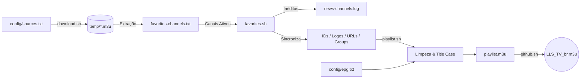

<div align="center">

# 📺 Gerenciador & Automação de Playlist IPTV (`LLS_TV_br.m3u`)

**Pipeline modular em Bash + GitHub Actions para agregação, curadoria, higienização e publicação automática de canais IPTV.**

[](../../actions)
[](#-arquitetura-do-projeto)
[](https://github.io)

<br>

### 🔗 Link Direto da Playlist (Pronto para Players IPTV)
```text
https://github.io
```

</div>

---

## ✨ Visão Geral

Este projeto automatiza todo o ciclo de vida de uma playlist IPTV personalizada:

1. **Coleta Multi-Fonte (`download.sh`)**: Baixa listas M3U de múltiplas origens, extrai metadados (`tvg-id`, `tvg-logo`, `URL`) e cataloga novos canais automaticamente como inativos (`#`) para revisão.
2. **Curadoria & Descoberta (`favorites.sh`)**: Sincroniza URLs, logos e IDs atualizados para os canais aprovados, preserva edições manuais de grupos/metadados e registra canais inéditos no topo do log cronológico (`news-channels.log`).
3. **Higienização & Build (`playlist.sh`)**: Injeta o guia de programação (EPG), remove tags poluentes (`clean-words.txt`), padroniza capitalização (`format-names.txt`) e gera a playlist final limpa (`playlist.m3u`).
4. **Deploy & Automação Cloud (`github.sh`)**: Publica toda a estrutura no repositório `lls-ws.github.io` e configura o **GitHub Actions** para renovar tokens e links todos os dias às **06:00 (horário de Brasília)**.

---

## 🔄 Fluxo de Processamento



---

## 📂 Arquitetura do Projeto

```text
iptv/
├── README.md                     # Documentação oficial do projeto (exibida no GitHub)
├── run.sh                        # Script Gerenciador Principal (CLI)
├── playlist.m3u                  # Playlist final compilada localmente
├── LLS_TV_br.m3u                 # Playlist publicada e atualizada via GitHub Actions
│
├── config/                       # Configurações e regras de filtragem
│   ├── epg.txt                   # URL do guia de programação (formato: epg_name#epg_url)
│   ├── sources.txt               # Fontes M3U (formato: source_name#source_url)
│   ├── clean-words.txt           # Palavras e sufixos removidos dos nomes dos canais
│   └── format-names.txt          # Lista de canais convertidos para Title Case
│
├── favorites/                    # Base de curadoria e metadados persistentes
│   ├── favorites-channels.txt    # Lista mestra ('#' = ignorado | sem '#' = ativo)
│   ├── favorites-ids.txt         # IDs EPG (formato: source_name#channel_name#channel_id)
│   ├── favorites-urls.txt        # Links ativos (formato: source_name#channel_name#channel_url)
│   ├── favorites-logos.txt       # Logotipos (formato: source_name#channel_name#channel_logo)
│   ├── favorites-groups.txt      # Categorias (formato: source_name#channel_name#channel_group)
│   └── news-channels.log         # Histórico cronológico de novos canais descobertos
│
├── scripts/                      # Módulos de execução do pipeline
│   ├── download.sh               # Etapa 1: Download e extração de metadados
│   ├── favorites.sh              # Etapa 2: Cruzamento de favoritos e log de novidades
│   ├── playlist.sh               # Etapa 3: Montagem, EPG e formatação de nomes
│   └── github.sh                 # Etapa 4: Deploy e configuração do GitHub Actions
│
└── temp/                         # Arquivos temporários de processamento (ignorado no Git)
```

---

## 🚀 Guia de Uso (`run.sh`)

Todas as operações do projeto são centralizadas através do gerenciador `run.sh`.

### ⚙️ Comandos de Execução

| Comando | Ação Executada | Descrição |
| :--- | :--- | :--- |
| `bash run.sh all` | **Etapas 1 + 2 + 3** | Executa o ciclo completo: baixa listas, sincroniza favoritos e gera `playlist.m3u`. |
| `bash run.sh download` | **Etapa 1** (`download.sh`) | Baixa as fontes de `sources.txt` e adiciona novos canais comentados (`#`). |
| `bash run.sh favorites` | **Etapa 2** (`favorites.sh`) | Atualiza URLs/IDs/Logos dos ativos e registra novidades em `news-channels.log`. |
| `bash run.sh playlist` | **Etapa 3** (`playlist.sh`) | Gera `playlist.m3u` aplicando EPG, `clean-words.txt` e `format-names.txt`. |
| `bash run.sh update` | **Etapa 4** (`github.sh`) | Envia o projeto para `lls-ws.github.io` e atualiza `LLS_TV_br.m3u`. |

### ✏️ Comandos de Edição e Curadoria

| Comando | Arquivos Abertos no Editor | Finalidade |
| :--- | :--- | :--- |
| `bash run.sh news` | `favorites/news-channels.log` | Visualizar os canais inéditos descobertos na última busca (ordenados por data). |
| `bash run.sh edit-favs` | `favorites/favorites-channels.txt` | Ativar canais removendo o `#` do início da linha. |
| `bash run.sh edit-meta` | `groups`, `logos`, `ids`, `urls` | Editar manualmente categorias (`group-title`), logos ou links específicos. |
| `bash run.sh edit-sources` | `config/sources.txt`, `config/epg.txt` | Adicionar/remover URLs de listas M3U ou alterar a fonte do EPG. |
| `bash run.sh edit-config` | `clean-words.txt`, `format-names.txt` | Ajustar palavras removidas ou canais formatados em Title Case. |
| `bash run.sh edit-docs` | `README.md` | Editar esta documentação. |
| `bash run.sh show` | `playlist.m3u` | Inspecionar o resultado final da playlist gerada. |

---

## 🤖 Automação na Nuvem (GitHub Actions)

O script `scripts/github.sh` gera automaticamente o workflow `.github/workflows/update-iptv.yml` dentro do repositório `lls-ws.github.io`.

* **Agendamento Automático**: Executa todos os dias às **06:00 (UTC-3 / Brasília)** para renovar links com tokens temporários (Pluto, LG, Samsung, TCL, Whale, etc.).
* **Execução Manual**: Pode ser disparado sob demanda a qualquer momento na aba **Actions** do GitHub clicando em **Run workflow**.

### ⚠️ Configuração Obrigatória no GitHub (Primeiro Uso)
Para que o GitHub Actions consiga realizar o *commit* automático da playlist atualizada:
1. Acesse o repositório **`lls-ws.github.io`** no GitHub.
2. Navegue até **Settings** > **Actions** > **General**.
3. Em **Workflow permissions**, selecione **Read and write permissions** e clique em **Save**.

---

<div align="center">
  <sub>Desenvolvido por <b>Leandro Luiz</b> • Mantido via Bash & GitHub Actions</sub>
</div>
