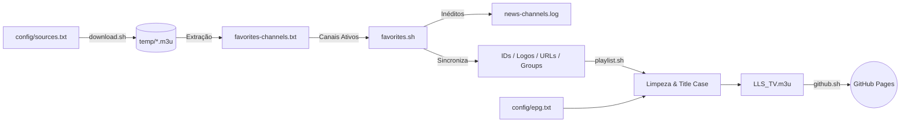

<div align="center">

# 📺 Gerenciador & Automação de Playlist IPTV (`LLS_TV.m3u`)

**Pipeline modular em Bash + GitHub Actions para agregação, curadoria, higienização e publicação automática de canais IPTV.**

[](#painel)
[](https://github.com/lls-ws/lls-ws.github.io/actions/workflows/update-iptv.yml)
[](#-guia-de-uso-runsh)
[](https://lls-ws.github.io/iptv/LLS_TV.m3u)

</div>

### 🔗 Link Direto da Playlist (Pronto para Players IPTV)
```text
https://lls-ws.github.io/iptv/LLS_TV.m3u
```

---

<a name="painel"></a>

## 🎛️ Painel de Controle Rápido

### ⚙️ Arquivos de Configuração

| Categoria | Arquivos |
| :--- | :--- |
| **Fontes** | [epg.txt](https://github.com/lls-ws/lls-ws.github.io/blob/main/iptv/config/epg.txt) • [sources.txt](https://github.com/lls-ws/lls-ws.github.io/blob/main/iptv/config/sources.txt) |
| **Metadados** | [favorites-ids.txt](https://github.com/lls-ws/lls-ws.github.io/blob/main/iptv/favorites/favorites-ids.txt) • [favorites-urls.txt](https://github.com/lls-ws/lls-ws.github.io/blob/main/iptv/favorites/favorites-urls.txt) • [favorites-logos.txt](https://github.com/lls-ws/lls-ws.github.io/blob/main/iptv/favorites/favorites-logos.txt) |
| **Canais Ativos/EPG** | [favorites-channels.txt](https://github.com/lls-ws/lls-ws.github.io/blob/main/iptv/favorites/favorites-channels.txt) • [channels.xml](https://github.com/lls-ws/lls-ws.github.io/blob/main/iptv/config/channels.xml) | 
| **Grupos & Ordem** | [groups-map.txt](https://github.com/lls-ws/lls-ws.github.io/blob/main/iptv/config/groups-map.txt) • [groups-map-order.txt](https://github.com/lls-ws/lls-ws.github.io/blob/main/iptv/config/groups-map-order.txt) • [favorites-groups.txt](https://github.com/lls-ws/lls-ws.github.io/blob/main/iptv/favorites/favorites-groups.txt) |
| **Filtros & Nomes** | [clean-words.txt](https://github.com/lls-ws/lls-ws.github.io/blob/main/iptv/config/clean-words.txt) • [format-names.txt](https://github.com/lls-ws/lls-ws.github.io/blob/main/iptv/config/format-names.txt) • [providers-priority.txt](https://github.com/lls-ws/lls-ws.github.io/blob/main/iptv/config/providers-priority.txt) |

### 📊 Monitoramento, Automação e Arquivos Finais

| Tipo | Arquivos |
| :--- | :--- |
| **Logs IPTV** |  [update-iptv.log](https://github.com/lls-ws/lls-ws.github.io/blob/main/iptv/favorites/update-iptv.log) • [news-channels.log](https://github.com/lls-ws/lls-ws.github.io/blob/main/iptv/favorites/news-channels.log) <br> [duplicates.log](https://github.com/lls-ws/lls-ws.github.io/blob/main/iptv/favorites/duplicates.log) • [broken-links.log](https://github.com/lls-ws/lls-ws.github.io/blob/main/iptv/favorites/broken-links.log) |
| **Logs EPG** | [update-epg.log](https://github.com/lls-ws/lls-ws.github.io/blob/main/iptv/log/update-epg.log) |
| **Resumo** | [Fontes M3U](https://github.com/lls-ws/lls-ws.github.io/blob/main/iptv/docs/m3u-sources.md) • [Canais IPTV](https://github.com/lls-ws/lls-ws.github.io/blob/main/iptv/docs/channels-resume.md) <br> [Fontes EPG](https://github.com/lls-ws/lls-ws.github.io/blob/main/iptv/docs/epg-sources.md) • [Canais EPG](https://github.com/lls-ws/lls-ws.github.io/blob/main/iptv/docs/channels-summary.md) |
| **GitHub Actions** | [update-iptv.yml](https://github.com/lls-ws/lls-ws.github.io/blob/main/.github/workflows/update-iptv.yml) • [update-epg.yml](https://github.com/lls-ws/epg/blob/master/.github/workflows/update-epg.yml)  |
| **Saídas Finais** | [LLS_TV.m3u](https://github.com/lls-ws/lls-ws.github.io/blob/main/iptv/LLS_TV.m3u) • [guide.xml](https://github.com/lls-ws/lls-ws.github.io/blob/main/iptv/guide.xml) |

---

## ✨ Visão Geral

Este projeto automatiza todo o ciclo de vida de uma playlist IPTV personalizada:

1. **Coleta Multi-Fonte (`download.sh`)**: Baixa listas M3U de múltiplas origens, extrai metadados (`tvg-id`, `tvg-logo`, `URL`) e cataloga novos canais automaticamente como inativos (`#`) para revisão.
2. **Curadoria & Descoberta (`favorites.sh`)**: Sincroniza URLs, logos e IDs atualizados para os canais aprovados, preserva edições manuais de grupos/metadados e registra canais inéditos no topo do log cronológico (`news-channels.log`).
3. **Higienização & Build (`playlist.sh`)**: Injeta o guia de programação (EPG), remove tags poluentes (`clean-words.txt`), padroniza capitalização (`format-names.txt`) e gera a playlist final limpa (`LLS_TV.m3u`).
4. **Deploy & Automação Cloud (`github.sh`)**: Limpa arquivos temporários e envia as alterações diretamente para o repositório `lls-ws.github.io`, onde o **GitHub Actions** renova tokens e links toda segunda-feira às **05:00 (horário de Brasília)**.

---

## 🔄 Fluxo de Processamento



---

## 📂 Arquitetura do Projeto

```text
iptv/
├── README.md                     # Documentação oficial do projeto (exibida no GitHub)
├── .gitignore                    # Regras para ignorar temp/ e arquivos temporários
├── run.sh                        # Script Gerenciador Principal (CLI)
├── LLS_TV.m3u                    # Playlist final compilada e publicada no GitHub Pages
│
├── config/                       # Configurações e regras de filtragem
│   ├── epg.txt                   # URL do guia de programação (formato: epg_name#epg_url)
│   ├── sources.txt               # Fontes M3U (formato: source_name#source_url)
│   ├── clean-words.txt           # Palavras e sufixos removidos dos nomes dos canais
│   ├── format-names.txt          # Lista de canais convertidos para Title Case
│   ├── groups-map.txt            # Dicionário de palavras-chave para categorização por gênero
│   ├── groups-map-order.txt      # Ordem de exibição dos grupos no player (order_number#group_map)
│   └── providers-priority.txt    # Ranking de prioridade dos provedores para deduplicação
│
├── favorites/                    # Base de curadoria, metadados e logs persistentes
│   ├── favorites-channels.txt    # Lista mestra ('#' = ignorado | sem '#' = ativo)
│   ├── favorites-ids.txt         # IDs EPG (formato: source_name#channel_name#channel_id)
│   ├── favorites-urls.txt        # Links ativos (formato: source_name#channel_name#channel_url)
│   ├── favorites-logos.txt       # Logotipos (formato: source_name#channel_name#channel_logo)
│   ├── favorites-groups.txt      # Categorias (formato: source_name#channel_name#channel_group)
│   ├── news-channels.log         # Histórico cronológico de novos canais descobertos
│   ├── broken-links.log          # Relatório de validação de streams e links offline
│   └── duplicates.log            # Relatório de canais duplicados e herança de ID/Logo
│
├── scripts/                      # Módulos de execução do pipeline
│   ├── download.sh               # Etapa 1: Download e extração de metadados
│   ├── favorites.sh              # Etapa 2: Cruzamento de favoritos, grupos e log de novidades
│   ├── playlist.sh               # Etapa 3: Montagem, EPG, limpeza, ordenação e formatação
│   ├── github.sh                 # Etapa 4: Limpeza de temporários e push para o GitHub
│   ├── check.sh                  # Etapa Extra (check / disable-broken): Teste HTTP e limpeza offline
│   └── dedupe.sh                 # Etapa Extra (dedupe / dedupe-apply): Deduplicação e resgate de ID/Logo
│
└── temp/                         # Arquivos temporários de processamento (ignorado no Git)
```

---

## 🚀 Guia de Uso (`run.sh`)

Todas as operações do projeto são centralizadas através do gerenciador `run.sh`.

### ⚙️ Comandos de Execução e Manutenção

| Comando | Ação Executada | Descrição |
| :--- | :--- | :--- |
| `bash run.sh all` | **Etapas 1 + 2 + 3** | Executa o ciclo completo: baixa listas, sincroniza favoritos e gera `LLS_TV.m3u`. |
| `bash run.sh download` | **Etapa 1** (`download.sh`) | Baixa as fontes de `sources.txt` e adiciona novos canais comentados (`#`). |
| `bash run.sh favorites` | **Etapa 2** (`favorites.sh`) | Atualiza URLs/IDs/Logos, aplica `groups-map.txt` e registra novidades em `news-channels.log`. |
| `bash run.sh playlist` | **Etapa 3** (`playlist.sh`) | Gera `LLS_TV.m3u` com EPG, limpeza de trackers, formatação e ordenação de grupos. |
| `bash run.sh check` | **Validação** (`check.sh`) | Testa todos os links da `LLS_TV.m3u` e salva o relatório em `broken-links.log`. |
| `bash run.sh disable-broken` | **Limpeza de Offline** | Comenta (`#`) em `favorites-channels.txt` os canais que falharam no `broken-links.log`. |
| `bash run.sh dedupe` | **Simular Duplicados** | Analisa canais repetidos e gera `duplicates.log` sem alterar os arquivos. |
| `bash run.sh dedupe-apply` | **Deduplicar & Herdar** | Herda `tvg-id`/`tvg-logo` dos duplicados e comenta (`#`) os de menor prioridade. |
| `bash run.sh update` | **Etapa 4** (`github.sh`) | Limpa `temp/` e envia as alterações e `LLS_TV.m3u` para o GitHub. |

### ✏️ Comandos de Edição e Curadoria

| Comando | Arquivos Abertos no Editor | Finalidade |
| :--- | :--- | :--- |
| `bash run.sh news` | `favorites/news-channels.log`, `favorites-channels.txt` | Visualizar os canais inéditos descobertos e ativar os desejados. |
| `bash run.sh edit-favs` | `favorites/favorites-channels.txt` | Ativar canais removendo o `#` do início da linha. |
| `bash run.sh edit-groups` | `groups-map.txt`, `groups-map-order.txt`, `favorites-groups.txt` | Gerenciar regras de gênero, ordem de exibição no player e exceções manuais. |
| `bash run.sh edit-meta` | `logos`, `ids`, `urls` | Editar manualmente logotipos, IDs de EPG ou links específicos. |
| `bash run.sh edit-prio` | `config/providers-priority.txt` | Definir a ordem de preferência dos provedores para remover duplicados. |
| `bash run.sh edit-sources` | `config/sources.txt`, `config/epg.txt` | Adicionar/remover URLs de listas M3U ou alterar a fonte do EPG. |
| `bash run.sh edit-config` | `clean-words.txt`, `format-names.txt` | Ajustar palavras removidas e formatação de nomes (Title Case). |
| `bash run.sh edit-docs` | `README.md` | Editar esta documentação. |
| `bash run.sh show` | `LLS_TV.m3u` | Inspecionar o resultado final da playlist gerada. |

---

## 🤖 Automação na Nuvem (GitHub Actions)

O workflow `.github/workflows/update-iptv.yml` (na raiz de `lls-ws.github.io`) automatiza a atualização periódica da playlist na nuvem.

* **Agendamento Automático**: Executa toda segunda-feira às **05:00 (UTC-3 / Brasília)** para renovar links com tokens temporários (Pluto, LG, Samsung, TCL, Whale, etc.).
* **Execução Manual**: Pode ser disparado sob demanda a qualquer momento na aba **Actions** do GitHub clicando em **Run workflow**.

### ⚠️ Configuração Obrigatória no GitHub (Primeiro Uso)
Para que o GitHub Actions consiga realizar o *commit* automático da playlist atualizada:
1. Acesse o repositório **`lls-ws.github.io`** no GitHub.
2. Navegue até **Settings** > **Actions** > **General**.
3. Em **Workflow permissions**, selecione **Read and write permissions** e clique em **Save**.

---

<div align="center">
  <sub>Desenvolvido por <b>Leandro Luiz</b> • Mantido via Bash & GitHub Actions</sub>
</div>
