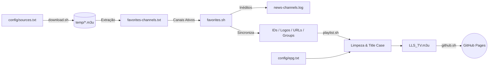

<div align="center">

# 📺 Gerenciador & Automação de Playlist IPTV (`LLS_TV.m3u`)

**Pipeline modular em Bash + GitHub Actions para agregação, curadoria, higienização e publicação automática de canais IPTV.**

[](https://github.com)
[](#-guia-de-uso-runsh)
[](https://github.io)
[](#-painel-de-controle-rápido)

</div>

### 🔗 Link Direto da Playlist (Pronto para Players IPTV)
```text
https://github.io
```

---

## 🎛️ Painel de Controle Rápido

Atalhos diretos para editar configurações e monitorar logs nos repositórios **`lls-ws.github.io`** e **`epg`**.

### ⚙️ Arquivos de Configuração (Acesso & Edição)

| Categoria | Arquivos (Visualizar) | Edição Rápida no GitHub |
| :--- | :--- | :--- |
| **Fontes & EPG** | [epg.txt](https://github.com) • [sources.txt](https://github.com) • [epg-sources.md](https://github.com) | [✏️ epg.txt](https://github.com) • [✏️ sources.txt](https://github.com) • [✏️ epg-sources.md](https://github.com) |
| **Canais Ativos** | [favorites-channels.txt](https://github.com) | [✏️ Editar Canais](https://github.com) |
| **Canais EPG (XML)** | [channels.xml](https://github.com) | [✏️ Editar XML](https://github.com) |
| **Grupos & Ordem** | [groups-map.txt](https://github.com) • [groups-map-order.txt](https://github.com) • [favorites-groups.txt](https://github.com) | [✏️ map](https://github.com) • [✏️ order](https://github.com) • [✏️ fav-groups](https://github.com) |
| **Metadados** | [favorites-ids.txt](https://github.com) • [favorites-urls.txt](https://github.com) • [favorites-logos.txt](https://github.com) | [✏️ ids](https://github.com) • [✏️ urls](https://github.com) • [✏️ logos](https://github.com) |
| **Filtros & Nomes** | [clean-words.txt](https://github.com) • [format-names.txt](https://github.com) • [providers-priority.txt](https://github.com) | [✏️ words](https://github.com) • [✏️ names](https://github.com) • [✏️ priority](https://github.com) |

### 📊 Monitoramento, Automação e Arquivos Finais

| Tipo | Recurso | Link Direto |
| :--- | :--- | :--- |
| **Logs IPTV** | Descobertas, Duplicados e Links Offline | [news-channels.log](https://github.com) • [duplicates.log](https://github.com) • [broken-links.log](https://github.com) |
| **Logs EPG** | Execução e Balanço de Cobertura | [update-epg.log](https://github.com) • [epg-status.md](https://github.com) *( [✏️ Editar](https://github.com) )* |
| **GitHub Actions** | Workflows de Atualização | [update-iptv.yml](https://github.com) *( [Actions](https://github.com) )* • [update-epg.yml](https://github.com) *( [Actions](https://github.com) )* |
| **Saídas Finais** | Playlist M3U e Guia XMLTV | [LLS_TV.m3u](https://github.com) • [guide.xml.gz](https://github.com) |

---

## ✨ Visão Geral

Este projeto automatiza todo o ciclo de vida de uma playlist IPTV personalizada:

1. **Coleta Multi-Fonte (`download.sh`)**: Baixa listas M3U de múltiplas origens, extrai metadados (`tvg-id`, `tvg-logo`, `URL`) e cataloga novos canais automaticamente como inativos (`#`) para revisão.
2. **Curadoria & Descoberta (`favorites.sh`)**: Sincroniza URLs, logos e IDs atualizados para os canais aprovados, preserva edições manuais de grupos/metadados e registra canais inéditos no topo do log cronológico (`news-channels.log`).
3. **Higienização & Build (`playlist.sh`)**: Injeta o guia de programação (EPG), remove tags poluentes (`clean-words.txt`), padroniza capitalização (`format-names.txt`) e gera a playlist final limpa (`LLS_TV.m3u`).
4. **Deploy & Automação Cloud (`github.sh`)**: Limpa arquivos temporários e envia as alterações diretamente para o repositório `lls-ws.github.io`, onde o **GitHub Actions** renova tokens e links toda segunda-feira às **05:00 (horário de Brasília)**.

---

## 🔄 Fluxo de Processamento



---

## 📂 Arquitetura do Projeto

```text
iptv/
├── README.md                     # Documentação oficial do projeto (exibida no GitHub)
├── .gitignore                    # Regras para ignorar temp/ e arquivos temporários
├── run.sh                        # Script Gerenciador Principal (CLI)
├── LLS_TV.m3u                    # Playlist final compilada e publicada no GitHub Pages
│
├── config/                       # Configurações e regras de filtragem
│   ├── epg.txt                   # URL do guia de programação (formato: epg_name#epg_url)
│   ├── sources.txt               # Fontes M3U (formato: source_name#source_url)
│   ├── clean-words.txt           # Palavras e sufixos removidos dos nomes dos canais
│   ├── format-names.txt          # Lista de canais convertidos para Title Case
│   ├── groups-map.txt            # Dicionário de palavras-chave para categorização por gênero
│   ├── groups-map-order.txt      # Ordem de exibição dos grupos no player (order_number#group_map)
│   └── providers-priority.txt    # Ranking de prioridade dos provedores para deduplicação
│
├── favorites/                    # Base de curadoria, metadados e logs persistentes
│   ├── favorites-channels.txt    # Lista mestra ('#' = ignorado | sem '#' = ativo)
│   ├── favorites-ids.txt         # IDs EPG (formato: source_name#channel_name#channel_id)
│   ├── favorites-urls.txt        # Links ativos (formato: source_name#channel_name#channel_url)
│   ├── favorites-logos.txt       # Logotipos (formato: source_name#channel_name#channel_logo)
│   ├── favorites-groups.txt      # Categorias (formato: source_name#channel_name#channel_group)
│   ├── news-channels.log         # Histórico cronológico de novos canais descobertos
│   ├── broken-links.log          # Relatório de validação de streams e links offline
│   └── duplicates.log            # Relatório de canais duplicados e herança de ID/Logo
│
├── scripts/                      # Módulos de execução do pipeline
│   ├── download.sh               # Etapa 1: Download e extração de metadados
│   ├── favorites.sh              # Etapa 2: Cruzamento de favoritos, grupos e log de novidades
│   ├── playlist.sh               # Etapa 3: Montagem, EPG, limpeza, ordenação e formatação
│   ├── github.sh                 # Etapa 4: Limpeza de temporários e push para o GitHub
│   ├── check.sh                  # Etapa Extra (check / disable-broken): Teste HTTP e limpeza offline
│   └── dedupe.sh                 # Etapa Extra (dedupe / dedupe-apply): Deduplicação e resgate de ID/Logo
│
└── temp/                         # Arquivos temporários de processamento (ignorado no Git)
```

---

## 🚀 Guia de Uso (`run.sh`)

